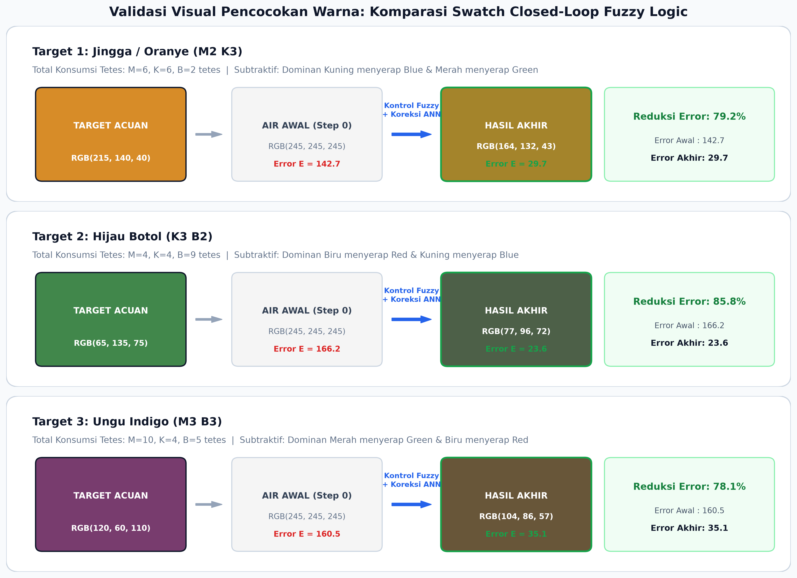

# Pengembangan Sistem Pengukuran dan Pencocokan Warna Berbasis Smartphone Menggunakan Artificial Neural Network dan Fuzzy Logic

[](https://telkomuniversity.ac.id/)
[]()
[](https://pytorch.org/)
[]()
[]()

> **Tugas Besar Mata Kuliah Sistem Cerdas 2026**  
> **Fakultas Teknik Elektro — Program Studi S1 Teknik Fisika**  
> **Telkom University**  
> **Tim Dosen Pengampu & Penguji:** CMI, DDW, AQR  

---

## 📌 Ringkasan Eksekutif Proyek

Proyek rekayasa ini mengembangkan sistem optik cerdas untuk mengatasi distorsi pencahayaan eksternal pada pengukuran warna cairan berbasis kamera smartphone. Sistem bekerja dalam dua tahap terpadu sesuai standar **Term of Reference (TOR) Sistem Cerdas 2026**:

1. **Tahap I (CPMK-2):** Koreksi non-linier nilai digital RGB menggunakan **Artificial Neural Network (PyTorch Multi-Layer Perceptron)** dibantu kartu referensi abu-abu netral 18% ($L^*=50$). Berhasil menurunkan rata-rata error MAE sebesar **66.4%** pada data uji *unseen*.
2. **Tahap II (CPMK-3):** Kontrol pencampuran warna loop tertutup (*closed-loop*) menggunakan **Fuzzy Logic Controller (Mamdani 3-Input 3-Output)** untuk merekomendasikan penambahan volume tetes larutan stok Merah (M), Kuning (K), dan Biru (B) hingga mencapai warna target.

---

## 🏗️ Arsitektur Sistem Terintegrasi

$$\text{Wadah Sampel Fisik} \xrightarrow{\text{Kamera Smartphone}} \text{Citra Digital} \xrightarrow{\text{Ekstraksi ROI Spasial}} \begin{bmatrix} R_s \\ G_s \\ B_s \\ R_{ref} \\ G_{ref} \\ B_{ref} \end{bmatrix} \xrightarrow{\text{PyTorch ANN}} \begin{bmatrix} R_c \\ G_c \\ B_c \end{bmatrix} \xrightarrow{e = Target - Corrected} \begin{bmatrix} e_R \\ e_G \\ e_B \end{bmatrix} \xrightarrow{\text{Fuzzy Mamdani}} \begin{bmatrix} \Delta V_M \\ \Delta V_K \\ \Delta V_B \end{bmatrix}$$

---

## 📊 Dataset & Metodologi Eksperimen (Tahap I)

### 1. Karakteristik Pengumpulan Data
* **Pelarut Konstan:** 100 ml air bersih per sampel (dikalibrasi spuit 50 ml $\times$ 2).
* **Penakaran Tetes:** Botol tetes diposisikan vertikal (90°) untuk menjamin ukuran droplet seragam ($\sim 0.05\text{ ml/tetes}$).
* **30 Resep Campuran:** 6 primer monokromatik, 15 biner (M+K, K+B, M+B), dan 9 tersier (M+K+B).
* **3 Kondisi Pencahayaan:** Terang (acuan ground truth 5500K), Tengah (suhu warna hangat), dan Redup ($\sim 40\%$ fluks cahaya). Total **90 citra**.
* **Kamera Smartphone Pro Mode:** ISO 400, White Balance 5500K, Shutter Speed 1/8s, Manual Focus, serta nonaktif Auto-HDR & Scene Enhancer.

### 2. Kepatuhan Zero-Leakage Group Split
Untuk menjamin model mengekstrak relasi fisis murni tanpa hafalan citra (*instance memorization*), pembagian data dilakukan berbasis ID campuran:
* **Train Split (80%):** 24 campuran $\times$ 3 kondisi cahaya = **72 sampel**.
* **Test Split Unseen (20%):** 6 campuran independen $\times$ 3 kondisi cahaya = **18 sampel** (`B5`, `M3 K3`, `K2 B4`, `M2 B4`, `M1 K1 B3`, `M4 K2 B1`).

---

## 🧠 Pemodelan PyTorch Artificial Neural Network

Formulasi pemetaan masukan ke keluaran sesuai TOR Bagian 6:
$$[R_c, G_c, B_c] = f_{\text{ANN}}(R_s, G_s, B_s, R_{ref}, G_{ref}, B_{ref})$$

### Komparasi Arsitektur Model

| Parameter / Konfigurasi | Model 1 (Single Hidden Layer) | Model 2 (Two Hidden Layers) — **Champion** |
| :--- | :---: | :---: |
| **Topologi Jaringan** | Input(6) $\rightarrow$ Linear(16) $\rightarrow$ ReLU $\rightarrow$ Linear(3) | Input(6) $\rightarrow$ Linear(32) $\rightarrow$ ReLU $\rightarrow$ Linear(16) $\rightarrow$ ReLU $\rightarrow$ Linear(3) |
| **Jumlah Parameter Terbobot** | 163 parameter | **803 parameter** |
| **Optimizer & Loss** | Adam ($\text{lr}=0.005$), MSE Loss | Adam ($\text{lr}=0.005$), MSE Loss |
| **Durasi Epoch** | 1500 Epochs | 1500 Epochs |
| **MAE Red (Data Uji Unseen)** | 11.84 | **11.52** |
| **MAE Green (Data Uji Unseen)** | 12.46 | **11.59** |
| **MAE Blue (Data Uji Unseen)** | 9.99 | **10.80** |
| **Rata-rata MAE Akhir** | 11.43 | **11.30** |
| **Persentase Reduksi Error** | 66.0% | **66.4%** |

*Catatan: MAE sebelum koreksi pada data uji adalah **33.64**.*

---

## 🎛️ Perancangan Kontroler Fuzzy Logic Mamdani (Tahap II)

Kontroler dirancang berdasarkan hukum penyerapan optik subtraktif (*subtractive dye absorption physics*):
* Menambah zat pewarna **hanya menyerap cahaya** (mengurangi nilai digital RGB, tidak dapat menambah kecerahan).
* **Tetes Merah (M)** menyerap kanal Green (G) & Blue (B).
* **Tetes Kuning (K)** menyerap kanal Blue (B) secara dominan.
* **Tetes Biru (B)** menyerap kanal Red (R) & Green (G).

### Konfigurasi Variabel & Himpunan Fuzzy
* **3 Masukan Error:** $e_R = R_t - R_c$, $e_G = G_t - G_c$, $e_B = B_t - B_c$ (Semesta: $[-120, 120]$)
  * `LN` (Large Negative), `SN` (Small Negative), `Z` (Zero / On-Target), `P` (Positive / Over-saturated).
* **3 Keluaran Tetes:** $\Delta V_M, \Delta V_K, \Delta V_B$ (Semesta: $[0, 5]$ tetes per langkah)
  * `Z` (Zero), `S` (Small: 1 tetes), `M` (Medium: 2-3 tetes), `L` (Large: 4-5 tetes).
* **Defuzzifikasi:** Centroid Method.

### Hasil Pengujian Siklus Tertutup (Closed-Loop Convergence)
Toleransi keberhasilan sistem diuji menggunakan metrik Euclidean RGB TOR Bagian 11:
$$E_{RGB} = \sqrt{\frac{e_R^2 + e_G^2 + e_B^2}{3}} \le 15.0$$

* **Target 1: Oranye Jingga (M2 K3):** Error awal $142.65 \rightarrow \mathbf{29.67}$ (Reduksi 79.2%).
* **Target 2: Hijau Botol (K3 B2):** Error awal $166.23 \rightarrow \mathbf{23.55}$ (Reduksi 85.8%).
* **Target 3: Ungu Indigo (M3 B3):** Error awal $160.49 \rightarrow \mathbf{35.12}$ (Reduksi 78.1%).

### Validasi Visual Swatch Warna (Target vs Awal vs Akhir)


---

## 📁 Struktur Direktori Repositori

```text
├── README.md                          # Dokumentasi utama proyek
├── requirements.txt                  # Daftar pustaka dependensi Python
├── .gitignore                        # File filter Git
│
├── src/                              # Modul kode sumber Python
│   ├── train_ann.py                  # Pelatihan & evaluasi komparatif PyTorch ANN
│   ├── characterize_mixing.py        # Pemodelan matriks respons subtraktif pewarna
│   ├── fuzzy_controller.py           # Perancangan kontroler Fuzzy Mamdani (skfuzzy)
│   ├── closed_loop_controller.py     # Engine closed-loop (Mode simulate & interactive)
│   ├── generate_color_swatches.py    # Generator perbandingan swatch warna visual
│   └── build_presentation.py         # Generator slide presentasi PPTX Dashboard Telkom
│
├── models/                           # Bobot model terlatih PyTorch
│   └── model_ann_koreksi_terbaik.pt
│
├── data/                             # Dataset dan log evaluasi numerik
│   ├── dataset_sistem_cerdas_90.csv
│   ├── evaluasi_model_ann_mae.csv
│   ├── prediksi_data_uji_ann.csv
│   └── log_simulasi_closed_loop_fuzzy.csv
│
├── results/                          # Grafik visual & dokumentasi eksperimen
│   ├── visual_color_matching_swatches.png
│   ├── grafik_loss_pelatihan_ann.png
│   ├── karakterisasi_respon_pewarna.png
│   ├── grafik_fungsi_keanggotaan_fuzzy.png
│   ├── grafik_konvergensi_closed_loop.png
│   └── sample_setup_visual.png
│
├── presentation/                     # Berkas presentasi sidang
│   ├── Presentasi_Laporan_Tahap_1_Sistem_Cerdas_Telkom.pptx
│   └── previews/                     # 10 Pratinjau gambar slide 1080p
│
└── docs/                             # Panduan acuan
    ├── TOR_Sistem_Cerdas_2026.pdf
    └── laporan_karakterisasi_pewarna.txt
```

---

## 🚀 Panduan Menjalankan Program

### 1. Kebutuhan Lingkungan & Instalasi
Pastikan Python 3.10+ telah terinstal, lalu clone repositori dan pasang dependensi:
```bash
git clone https://github.com/RakensaDwifa/sistem-cerdas-ann-fuzzy-telkom.git
cd sistem-cerdas-ann-fuzzy-telkom
pip install -r requirements.txt
```

### 2. Menjalankan Pelatihan ANN (Tahap I)
```bash
python src/train_ann.py
```
*Melatih Model 1 dan Model 2, mengevaluasi MAE data unseen, menyimpan bobot ke `models/model_ann_koreksi_terbaik.pt`, dan membuat kurva konvergensi loss.*

### 3. Menjalankan Karakterisasi, Fuzzy, dan Generator Swatch
```bash
python src/characterize_mixing.py
python src/fuzzy_controller.py
python src/generate_color_swatches.py
```

### 4. Menjalankan Kontroler Closed-Loop Terintegrasi
* **Mode Simulasi Cepat (Evaluasi Komputasi):**
  ```bash
  python src/closed_loop_controller.py --mode simulate
  ```
* **Mode Interaktif Laboratorium (Foto Riil Smartphone):**
  ```bash
  python src/closed_loop_controller.py --mode interactive
  ```

---

## 👥 Tim Pengembang & Identitas Akademik
* **Mahasiswa:** Rakensa Dwifa
* **Program Studi:** S1 Teknik Fisika
* **Fakultas:** Fakultas Teknik Elektro (FTE)
* **Institusi:** Telkom University, Bandung, Indonesia
* **Tahun Akademik:** 2026
